# UI review

All screenshots are of the real apps running locally with **invented data** (an "Example Employer", "Alex Example", dummy shops, dummy documents). No real personal data appears anywhere. The AI model was not running, so the assistant shows "AI model not running"; chat answers are not shown.

Generated with Playwright at 1280×900 (desktop), 1280×900 dark, and 390×844 (phone), at 2× pixel density. Reproduce: start Finance (`ATLAS_ALLOW_PLAIN=1 finance ui`), Documents (`library serve`) and Atlas (`python -m atlas`) with a throw-away `ATLAS_HOME`, then run a script that opens `http://atlas.localhost:8000/#/…`.

**How to comment:** open the pull request, go to "Files changed", find the image under `docs/screenshots/`, and comment on it (GitHub allows comments on images in the diff). Start the comment with the screenshot number, e.g. `UI-3`.

## Desktop, light

### UI-1 Overview
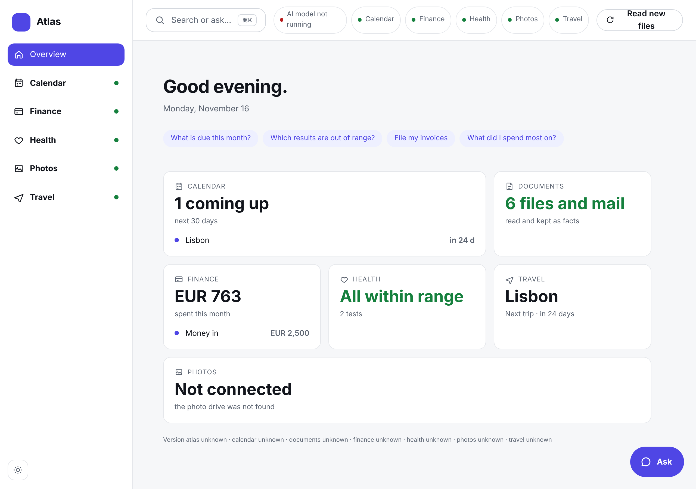

### UI-2 Finance dashboard
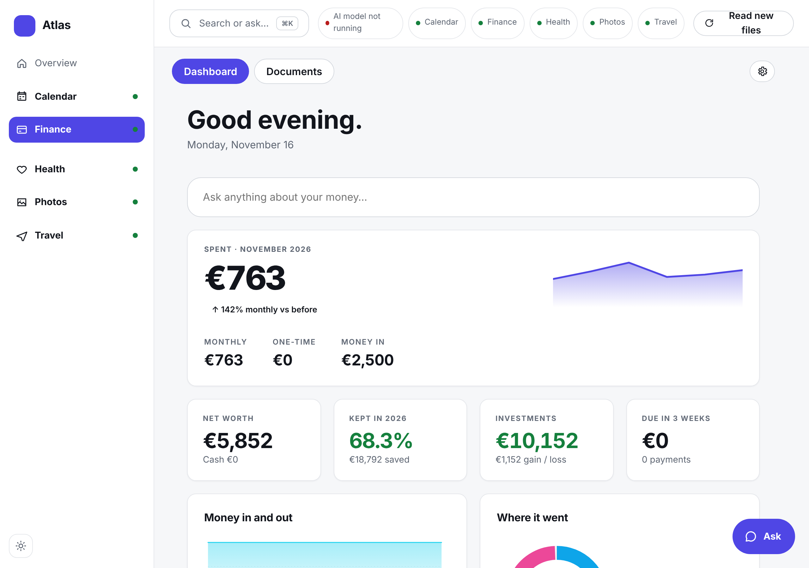

### UI-2b Finance dashboard, scrolled
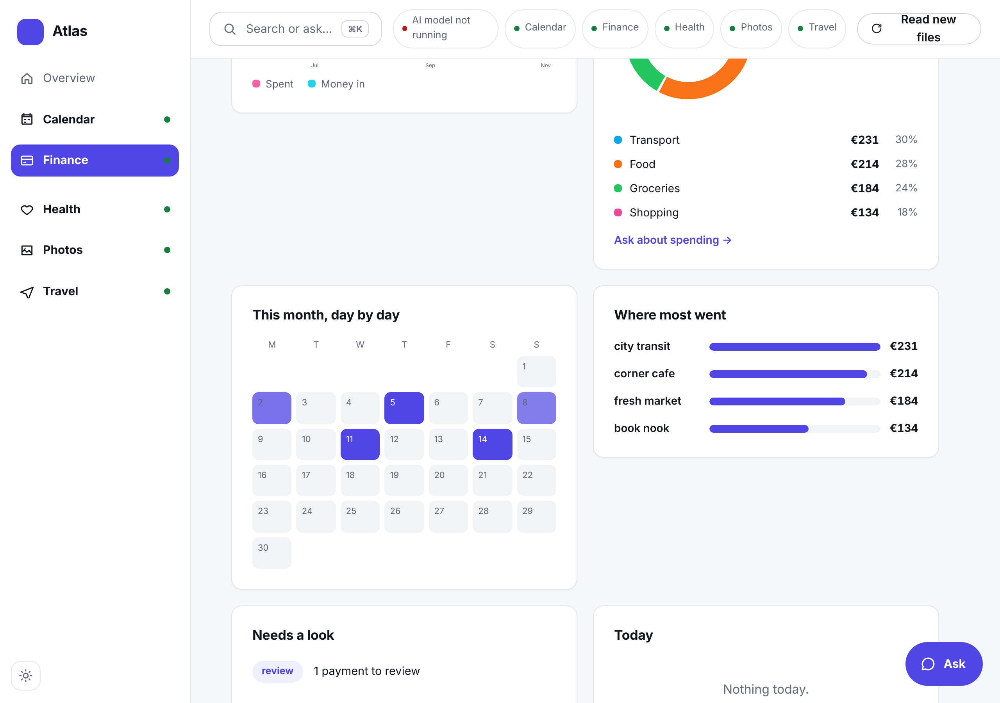

### UI-3 Health
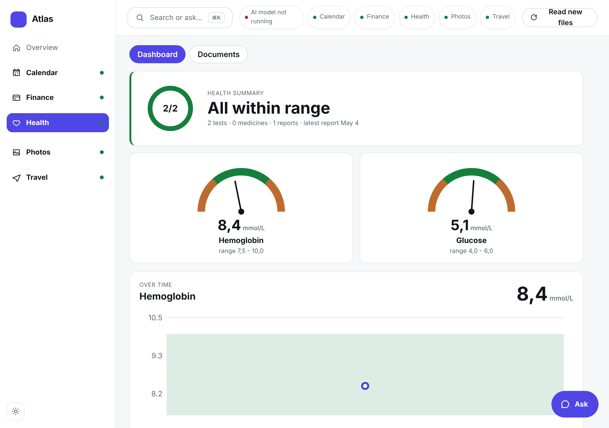

### UI-4 Travel
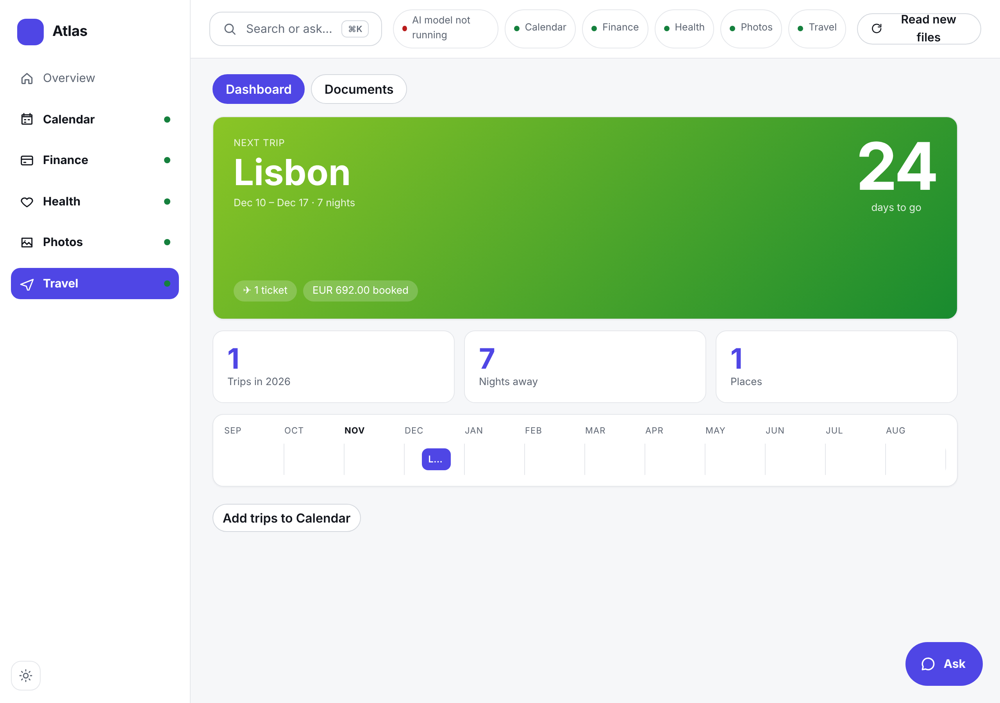

### UI-5 Photos (no photo drive is connected in this demo, so this is the "not connected" state)
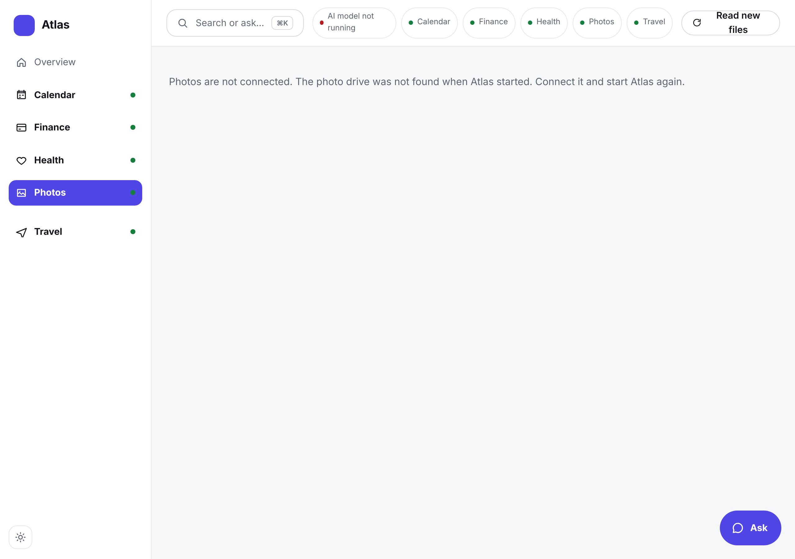

### UI-6 Calendar (the demo's events are in December, so November is empty)
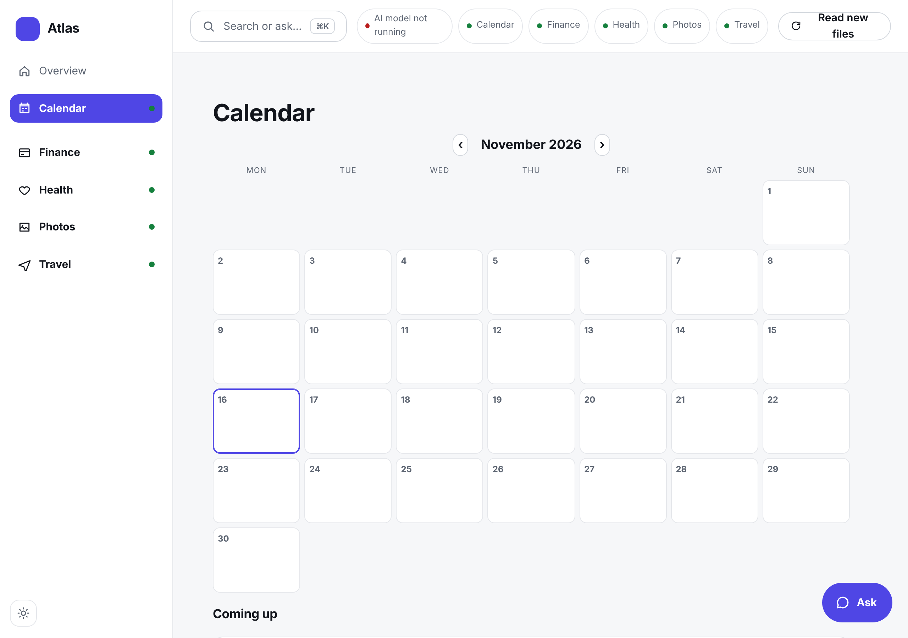

Documents has no page of its own: it is a hidden module that feeds Health, Travel, Photos and Calendar. Its stand-alone address only says "These pages belong inside Atlas".

## Dark

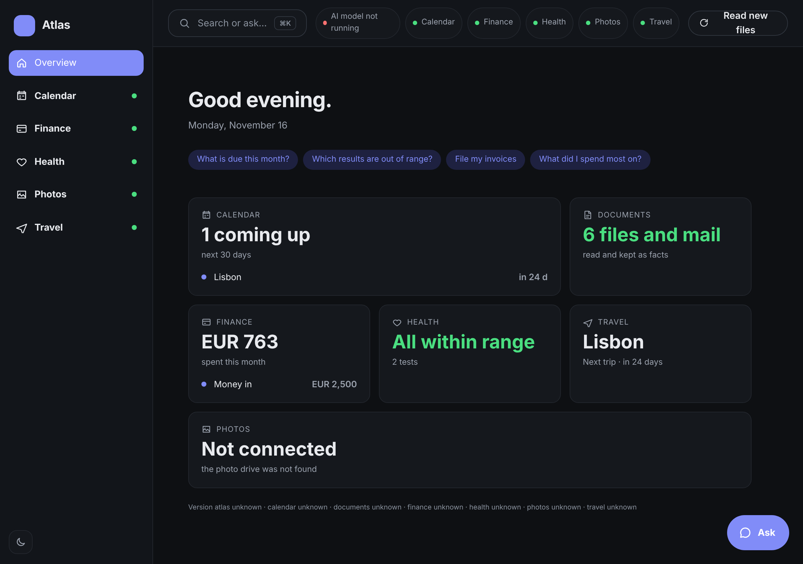
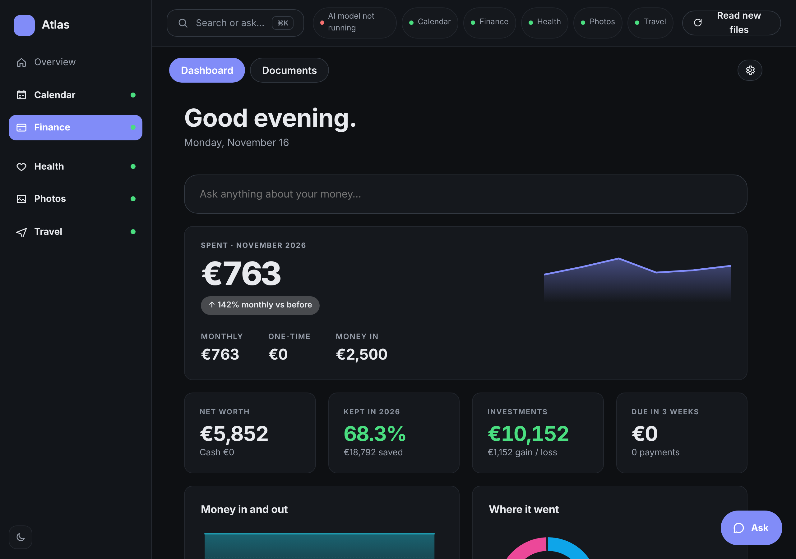
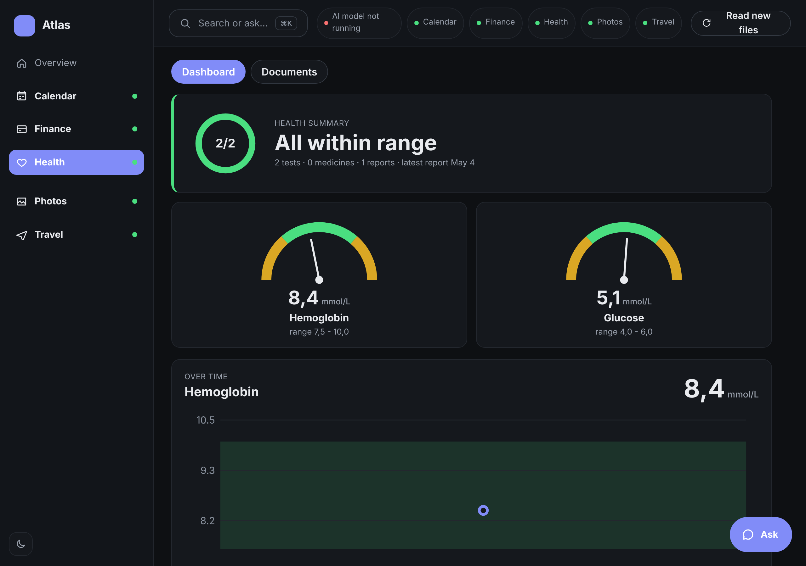

## Phone

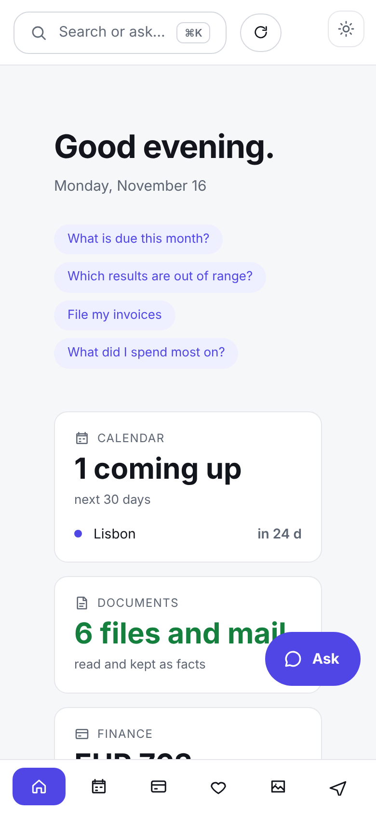 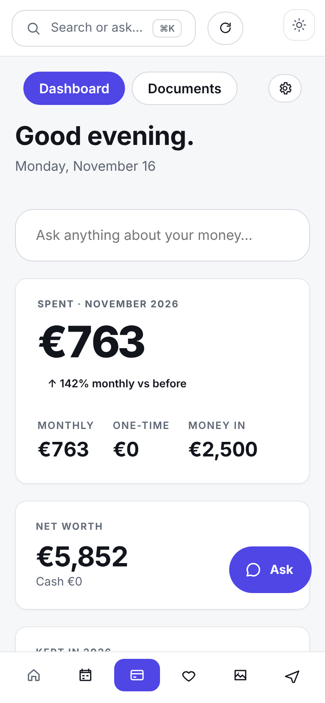 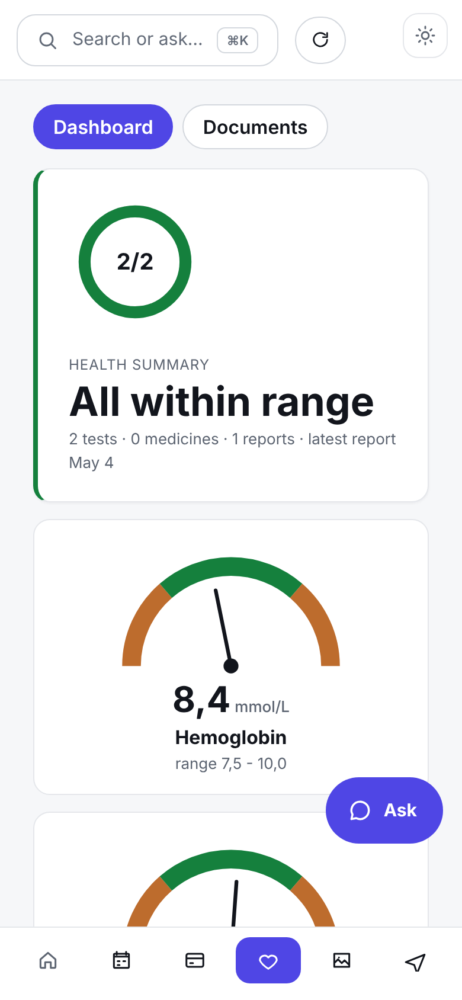

## What the author sees (to start the discussion)

| ID | Where | Observation | Rule it touches |
|---|---|---|---|
| UI-A | Travel hero | A green gradient. The design rule is "no gradients, one accent"; the Finance sparkline also fades | design.md |
| UI-B | Health | Reference ranges and values use the document's decimal comma (`8,4`), the chart axis uses a point (`9.3`) | R-Q1 plain, consistent numbers |
| UI-C | Health | "1 reports" (plural not handled); "0 medicines" shown though none were expected | plain words |
| UI-D | Phone | The floating **Ask** button covers part of the card behind it | usability |
| UI-E | Finance dashboard | "↑ 142% monthly vs before" is shown with no explanation of what "before" is | plain words |
| UI-F | Finance dashboard | "Due in 3 weeks €0 / 0 payments" cards that say nothing take the same space as cards with content | density |
| UI-G | Overview | The top bar has six status pills plus the Update button; on narrower widths the pill text wraps ("AI model not / running", "Read new / files") | layout |
| UI-H | All | Apps opened outside Atlas show a stub page for Documents ("These pages belong inside Atlas") and an empty-looking Finance shell; intended, but is it clear? | first run |
| UI-I | Photos | The sidebar dot and top pill for Photos are green while the page says "Photos are not connected" | honest status |
| UI-K | Calendar | An empty month is a grid of large blank boxes; "Coming up" is below the fold | density |
| UI-J | All | A pending change ("Waiting for your yes: …") is shown as a note under the answer, not as a card with a button; the owner must type "yes". Pictures use a window with a Confirm button | consistency of confirmation |

## One bug the screenshots found

Before this branch's last commit, every card on every page was invisible (`defects.md` D-12). The Finance dashboard looked like a greeting and an empty page. Please look at screenshots 02 and 02b, which show the fixed state, and tell me if anything still looks wrong or empty.
